# Failure-case analysis: draft of report §3–§4 (B-25)

> **DRAFT written by AI (P-009). The numbers are generated by `notebooks/04_selected_cases.ipynb` and the explanations are not final.**
> The "possible factors" below are hypotheses. Per AGENTS.md, the perceptual explanations belong to the team (B-13):
> look at each image at full size, keep or reject each factor, and rewrite it in your own words before it goes into the PDF.
> Lines marked *(verified)* were checked numerically. Everything else is unverified.

Dataset: KADID-10k, 81 references × 25 distortion types × 5 levels = 10,125 pairs, with MOS on a 1–5 scale (higher = better).
Failure mining uses the 9,805 pairs that are not pixel-identical (D-18). Pairs whose rater variance is above the 90th percentile can't be selected (D-24).

---

## 1. Metric direction vs subjective direction

KADID's `dmos` column is a mean opinion score where **higher = better quality** (1 = bad, 5 = excellent).
Every metric is first turned into an *aligned* score $\tilde s_m$ that is also higher = better:

$$
\tilde s_m(i) = \begin{cases} s_m(i) & m \in \{\text{PSNR, SSIM, MS-SSIM}\}\ \text{(similarity: higher = better)}\\ -\,s_m(i) & m \in \{\text{LPIPS-VGG, DISTS}\}\ \text{(distance: lower = better)}\end{cases}
$$

**Claim: after alignment, every metric's direction agrees with the MOS direction.** Evidence:

| metric | native direction | SRCC(raw $s_m$, MOS) | SRCC($\tilde s_m$, MOS) | PLCC after logistic |
|---|---|---|---|---|
| PSNR | higher = better | +0.676 | +0.676 | 0.680 |
| SSIM | higher = better | +0.619 | +0.619 | 0.628 |
| MS-SSIM | higher = better | +0.826 | +0.826 | 0.823 |
| LPIPS-VGG | lower = better | **−0.720** | +0.720 | 0.729 |
| DISTS | lower = better | **−0.814** | +0.814 | 0.814 |

- The raw SRCC is negative exactly for the two distance metrics. That is the expected sign, so these columns must be flipped, and after flipping every correlation is positive. *(verified, `results/tables/overall.csv`)*
- Every metric also scores a pixel-identical pair as perfect: PSNR = 80 dB (the cap), SSIM = 1, LPIPS ≈ 0, DISTS ≈ 0.
- `pyiqa`'s own `lower_better` flag is asserted against our registry when each model is created. *(verified, `tests/test_sanity.py`, `tests/test_evaluate.py`)*
- PLCC is computed on $\tilde s_m$ after a *monotonically increasing* VQEG 5-parameter logistic $f_m$, so the fit cannot reverse the direction.

## 2. Evaluation formulas

Let $N$ be the number of pairs and $y_i$ the MOS of pair $i$.

**Percentile rank** (used for every disagreement score, so dB, [0,1] similarities and feature distances become comparable):

$$
r_m(i) = \frac{\operatorname{rank}\big(\tilde s_m(i)\big)}{N} \in (0,1], \qquad r_{MOS}(i) = \frac{\operatorname{rank}(y_i)}{N}
$$

**SRCC** is Pearson's correlation between the two rank vectors. Without ties it equals

$$
\text{SRCC}_m = 1 - \frac{6\sum_i d_i^2}{N(N^2-1)}, \qquad d_i = \operatorname{rank}(\tilde s_m(i)) - \operatorname{rank}(y_i) = N\,\big(r_m(i) - r_{MOS}(i)\big)
$$

So the image with the largest $|r_m(i) - r_{MOS}(i)|$ costs the metric the most SRCC. That is the score used for case B-1.

**PLCC** is computed after the VQEG logistic, fitted on all 10,125 pairs with $z$-scored input:

$$
f_m(x) = \beta_1\Big(\tfrac12 - \tfrac{1}{1+e^{\beta_2 (x-\beta_3)}}\Big) + \beta_4 x + \beta_5, \qquad
\text{PLCC}_m = \frac{\operatorname{cov}\big(f_m(\tilde s_m), y\big)}{\sigma_{f_m(\tilde s_m)}\,\sigma_y}
$$

The residual $e_m(i) = f_m(\tilde s_m(i)) - y_i$ is in MOS units, so it can be compared across metrics.
The pairs with the largest $|e_m(i)|$ cost the metric the most PLCC. That is the score used for case B-2.

**Disagreement scores for the five cases** (each case takes the top-1; if an image was already used by an earlier case, the next candidate is taken):

| case | what disagrees | score | sign meaning |
|---|---|---|---|
| A-1 | SSIM vs MS-SSIM, same image | $g_{A}(i) = \lvert r_{SSIM}(i) - r_{MS\text{-}SSIM}(i)\rvert$ | – |
| A-2 | LPIPS-VGG vs DISTS, same image | $\lvert r_{LPIPS}(i) - r_{DISTS}(i)\rvert$ | – |
| B-1 | any metric vs MOS, rank view (SRCC) | $\lvert r_m(i) - r_{MOS}(i)\rvert$, maximised over $(m, i)$ | $>0$: metric too optimistic |
| B-2 | any metric vs MOS, value view (PLCC) | $\lvert e_m(i)\rvert$, maximised over $(m, i)$ | $>0$: metric too optimistic |
| C-1 | SSIM vs LPIPS-VGG *ranking* of two images $i, j$ of the same reference | $\min(\lvert\Delta r_{SSIM}\rvert, \lvert\Delta r_{LPIPS}\rvert)$ where $\Delta r = r^{ref}(i) - r^{ref}(j)$ and the two $\Delta r$ have opposite signs | humans side with whichever metric has the same sign as $\Delta MOS$; pairs with $\lvert\Delta MOS\rvert < 0.5$ are ties and are skipped |

$r^{ref}$ is the percentile rank *within one reference image*, so content difficulty cannot create a fake ranking conflict.
Full candidate lists: `results/failures/candidates_{A,B,C}.csv`. Selection: `results/failures/selected_report5.csv`.

## 3. Performance across distortion types and levels

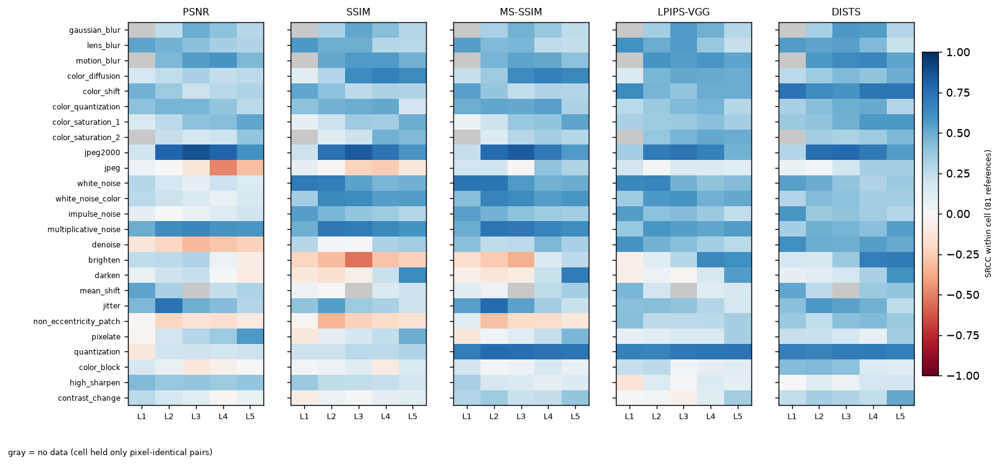

*SRCC inside each (distortion type, level) cell (81 images, one per reference). Gray = the cell only held pixel-identical pairs.*

Draft observations (to interpret, B-10):
- **Overall vs within-cell SRCC.** Within one cell, most metrics order the 81 images reasonably (blue). The low overall SRCC of SSIM (0.62) and PSNR (0.68) therefore comes mostly from **calibration across types**: a score of 0.99 does not mean the same quality for color diffusion as for blur. The heatmaps in §4 show this per case.
- Some cells are *inverted* (red) even within a single type: PSNR on **denoise**, **JPEG L3–L5** and **non-eccentricity patch**; SSIM and MS-SSIM on **brighten** and **non-eccentricity patch**. LPIPS-VGG and DISTS are almost never inverted.
- JPEG2000 is easy for every metric, and quantization for every metric except PSNR and SSIM. Contrast change and color block are hard for most metrics.

---

## 4. The five cases

Each case shows a figure (reference | distorted | |diff| | 1−SSIM map | LPIPS-VGG map, with scores and global ranks) and a heatmap. The heatmap's left panel is the case's signed score averaged per cell over all references; the right panel is the selected image's reference. The black box marks the selected image.

### A-1: SSIM vs MS-SSIM: `I18_04_04` (color diffusion, level 4)

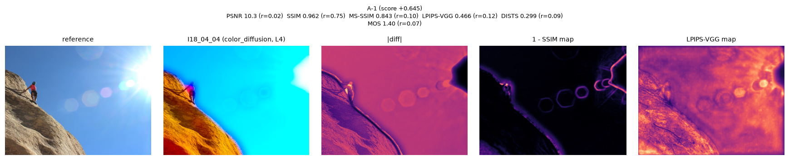
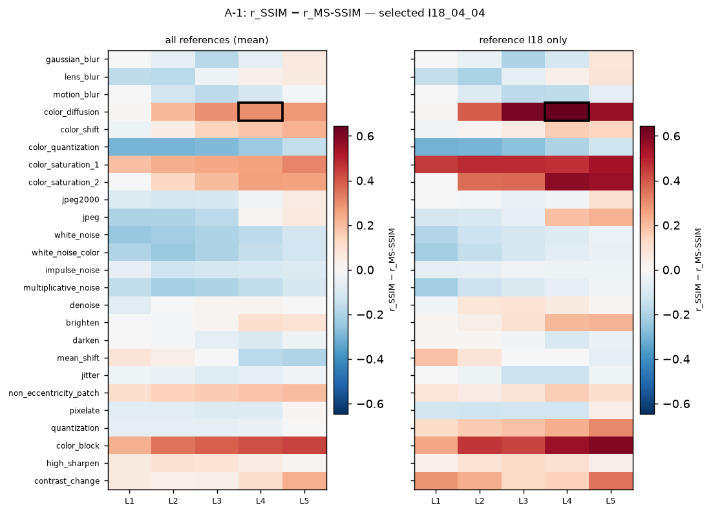

| | PSNR | SSIM | MS-SSIM | LPIPS-VGG | DISTS | MOS |
|---|---|---|---|---|---|---|
| score | 10.27 dB | 0.962 | 0.843 | 0.466 | 0.299 | 1.40 |
| global rank $r$ | 0.02 | **0.75** | **0.10** | 0.12 | 0.09 | 0.07 |

- **Disagreement:** $g_A = 0.645$, the largest SSIM–MS-SSIM gap in the dataset. SSIM calls this image better than 75% of the dataset. MS-SSIM, every other metric and the humans put it in the bottom 10%. **MS-SSIM agrees with humans.**
- **Systematic or isolated:** the left heatmap shows the same red pattern for **color diffusion, color saturation and color block** (mean gap up to +0.44) across all references. This is a family-wide difference between the two metrics, and I18 is its most extreme instance.
- **Possible factors (draft):**
  - *Scale / spatial extent* *(verified)*. Both metrics see only luma (YIQ Y), and its mean barely changes (151.9 → 152.3). The structure-contrast term $cs$ is 0.97 at the finest scale (the 11×11 window that SSIM uses) and falls steadily to 0.89, 0.81 and 0.72 at the coarser scales, which MS-SSIM weights most (0.30, 0.24, 0.13). The luma damage is a **large-scale, low-frequency** change: the bright halo around the sun and the sky/rock boundary are smeared. A small window sees each patch as "almost unchanged", while a large window sees the change.
  - *Color.* Most of the visible damage, the sky turning cyan and the rock orange, is in **chroma**, which neither metric sees. Here MS-SSIM is right for a partly wrong reason: it catches the luma side-effect of the color change. Compare B-1, where the color change has no luma side-effect and MS-SSIM fails too.

### A-2: LPIPS-VGG vs DISTS: `I38_19_04` (jitter, level 4)

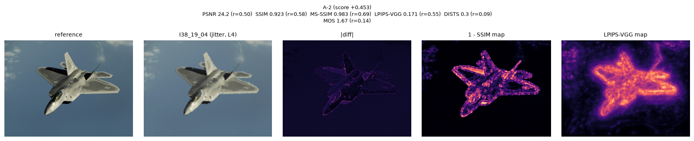
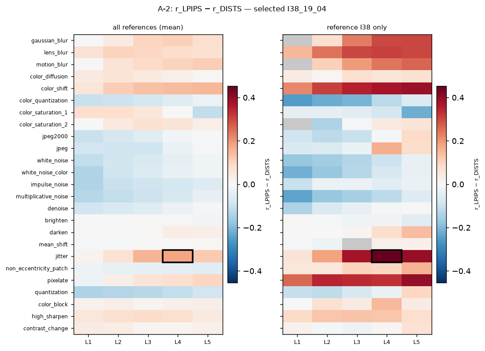

| | PSNR | SSIM | MS-SSIM | LPIPS-VGG | DISTS | MOS |
|---|---|---|---|---|---|---|
| score | 24.20 dB | 0.923 | 0.983 | 0.171 | 0.300 | 1.67 |
| global rank $r$ | 0.50 | 0.58 | 0.69 | **0.55** | **0.09** | 0.14 |

- **Disagreement:** gap 0.453. Both metrics use the same VGG16 backbone (D-23), so the difference comes from the **formula**. LPIPS-VGG places the image mid-pack, while DISTS and the humans place it near the bottom. **DISTS agrees with humans.**
- **Systematic or isolated:** within jitter alone both metrics order images almost perfectly (SRCC 0.94 LPIPS, 0.96 DISTS) *(verified)*. The failure is again **cross-type calibration**: the heatmap is red for jitter L3–L4 and color shift L4–L5 across all references, so LPIPS gives jitter smaller distances than its visual impact deserves.
- **Possible factors (draft):**
  - *Small geometric changes.* Jitter moves pixels by a few positions, so the outline of the jet becomes ragged (visible in the |diff| panel, concentrated on edges). LPIPS compares features **position by position** and averages them. Its learned weights come from 2AFC judgments on small patches, and those judgments may have taught it to discount small shifts.
  - *Structure vs texture statistics.* DISTS compares **global** mean and correlation statistics of each feature map (its structure term). Breaking every straight edge of a large, salient object changes those statistics a lot.
  - *Salient region.* All the damage is on the object, the region viewers look at. Neither metric weights saliency, but this could explain why the human score is so low.

### B-1: metric vs MOS, rank view (SRCC): SSIM on `I32_04_02` (color diffusion, level 2)

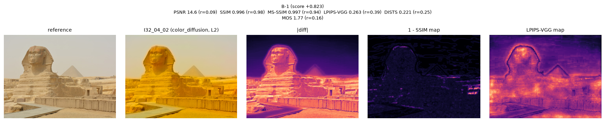
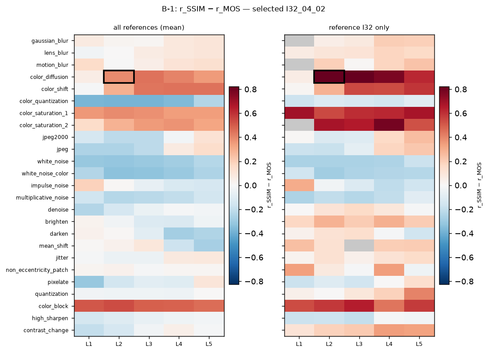

| | PSNR | SSIM | MS-SSIM | LPIPS-VGG | DISTS | MOS |
|---|---|---|---|---|---|---|
| score | 14.57 dB | **0.996** | 0.997 | 0.263 | 0.221 | 1.77 |
| global rank $r$ | 0.09 | **0.98** | 0.94 | 0.39 | 0.25 | 0.16 |

- **Disagreement:** $r_{SSIM} - r_{MOS} = +0.823$, the largest rank error of any metric on any image. SSIM is **too optimistic**: it rates the image better than 98% of the dataset, while humans rate it worse than 84%. In terms of $d_i$ this single image contributes $(0.823 N)^2$ to $\sum d^2$.
- **The same image tops the PLCC view too.** It has the largest logistic residual of all, $e_{SSIM} = +2.56$ MOS: SSIM's fitted MOS is 4.33, while humans gave 1.77. B-2 therefore shows the next distinct image.
- **Systematic or isolated:** systematic. SSIM is off by more than 0.5 rank for **20.7%** of color-diffusion images (and 21.7% of color saturation 1, 46.9% of color block). Yet within color diffusion SSIM's SRCC is 0.875 *(verified)*. It orders these images correctly but places all of them far too high relative to other distortion types. The heatmap is red along whole rows (color block, color diffusion, color saturation), not in isolated cells.
- **Possible factors (draft):**
  - *Color.* SSIM (and MS-SSIM) in pyiqa use **only the luma channel** (YIQ Y). Here the luma is almost unchanged: mean Y goes from 171.1 to 166.2, and $cs \ge 0.995$ at every scale *(verified)*. The distortion is a strong **yellow cast**, purely chromatic, so the metric cannot see it.
  - PSNR, which uses RGB, sees it (14.6 dB, rank 0.09), and so do LPIPS/DISTS, which use RGB features. The cue SSIM lacks is therefore color information, not some deeper perceptual model.

### B-2: metric vs MOS, value view (PLCC): DISTS on `I81_20_05` (non-eccentricity patch, level 5)

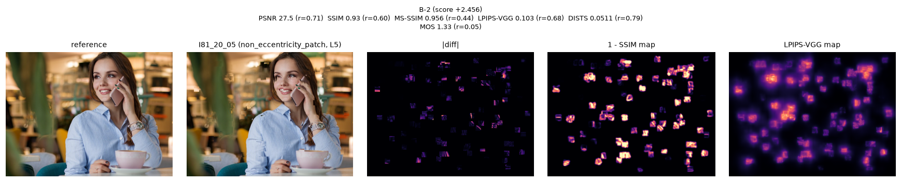
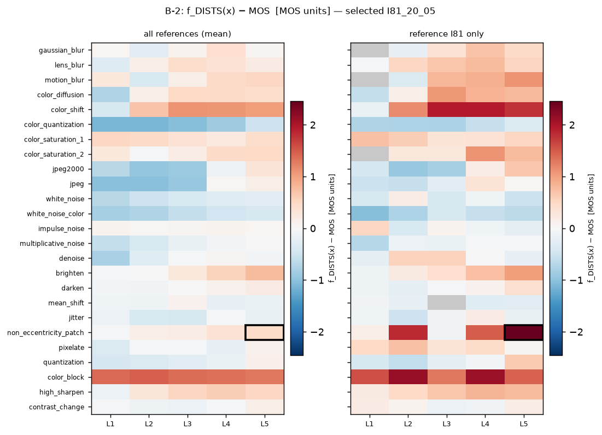

| | PSNR | SSIM | MS-SSIM | LPIPS-VGG | DISTS | MOS |
|---|---|---|---|---|---|---|
| score | 27.54 dB | 0.930 | 0.956 | 0.103 | **0.051** | 1.33 |
| global rank $r$ | 0.71 | 0.60 | 0.44 | 0.68 | **0.79** | 0.05 |
| fitted MOS $f_m(\tilde s)$ | | | | | **3.79** | 1.33 |

- **Disagreement:** $e_{DISTS} = +2.46$ MOS. The logistic mapping turns DISTS's very small distance into a predicted MOS of 3.79 ("good"), while humans gave 1.33 ("bad"). The residual is 2.46 points on a 4-point scale. This is the third-ranked (metric, image) pair overall, and the first one whose image is not already used by B-1. Every metric is optimistic here (all ranks ≥ 0.44), but DISTS is the most optimistic.
- **Systematic or isolated:** isolated. Only 1.2% of non-eccentricity-patch images have a DISTS rank error above 0.5, and within this type DISTS's SRCC is 0.67 *(verified)*. On the I81 row of the heatmap, L2 and L5 are dark red while L3 is near 0. The failure depends on **where the patches land**, not on the distortion type. (Across all references, DISTS's large positive residuals are on **color block** and **color shift**.)
- **Possible factors (draft):**
  - *Spatial localization.* This distortion copies many small patches to nearby positions. The damage is local and sparse (see the |diff| map); most of the image is untouched.
  - DISTS compares **global** feature statistics (means and variances over the whole map). Moving patches around inside the same image leaves those statistics almost unchanged. DISTS was in fact designed to tolerate this kind of texture resampling.
  - *Salient / semantic content.* The patches create small discontinuities on the shirt, hair, phone and cup edges, near the face. Viewers notice discontinuities on a person and on object contours much more than the area fraction suggests.

### C-1: SSIM vs LPIPS-VGG ranking: `I43_07_05` vs `I43_25_01` (reference I43)

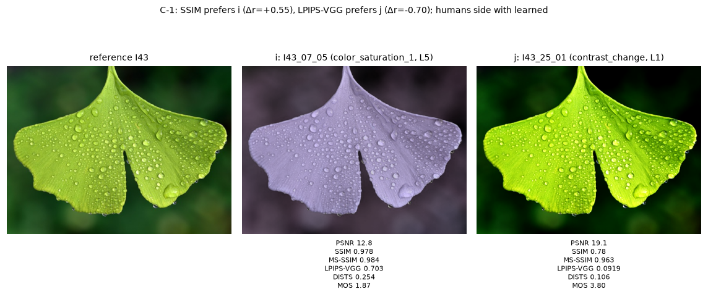
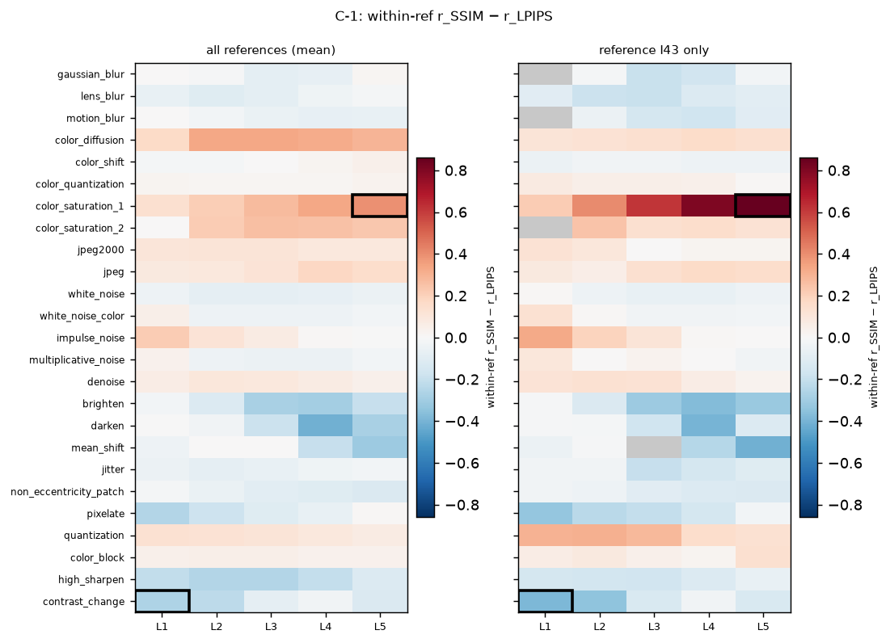

| image | type, level | SSIM | LPIPS-VGG | MOS | $r^{ref}_{SSIM}$ | $r^{ref}_{LPIPS}$ | $r^{ref}_{MOS}$ |
|---|---|---|---|---|---|---|---|
| $i$ = I43_07_05 | color saturation 1, L5 | 0.978 | 0.703 | 1.87 | **0.87** | **0.01** | 0.08 |
| $j$ = I43_25_01 | contrast change, L1 | 0.780 | 0.092 | 3.80 | **0.32** | **0.71** | 0.62 |

- **Disagreement:** $\Delta r_{SSIM} = +0.55$ (SSIM prefers $i$), $\Delta r_{LPIPS} = -0.70$ (LPIPS prefers $j$), strength 0.55, the strongest such conflict with a clear human preference. Humans prefer $j$ by **1.93 MOS**, so **humans side with LPIPS-VGG**. Over all 78,769 SSIM–LPIPS conflicts, humans side with LPIPS in 43%, with SSIM in 24%, and 34% are ties.
- **Systematic or isolated:** systematic. The left heatmap (within-reference $r_{SSIM} - r_{LPIPS}$) is red for color saturation, color diffusion and quantization, and blue for brighten, darken, mean shift, contrast change and high sharpen. SSIM is lenient on color changes and harsh on luminance and contrast changes compared with LPIPS.
- **Possible factors (draft):**
  - *Color (image $i$).* The leaf becomes lavender-gray: hue and saturation change while the luma structure (veins, drops) is intact. SSIM, which sees luma only, scores 0.978. LPIPS uses RGB deep features, which respond strongly to color, and scores it the worst image of the reference.
  - *Contrast (image $j$).* The contrast is increased: a brighter, more saturated leaf and a darker background. SSIM's contrast term $\frac{2\sigma_x\sigma_y + C_2}{\sigma_x^2 + \sigma_y^2 + C_2}$ penalises *any* change of local variance, including an increase. Humans see an "enhanced" leaf, and LPIPS's normalised deep features are relatively insensitive to such a global contrast change.

---

## 5. Summary of factors (draft for §4 / §5 discussion)

| case | metric that fails | factor it ignores or over-weights | systematic? |
|---|---|---|---|
| A-1 | SSIM | large-scale (low-frequency) changes: single small window | yes (color types) |
| A-2 | LPIPS-VGG | ragged edges from small geometric jitter; calibration across types | yes (jitter, color shift) |
| B-1 | SSIM (and MS-SSIM) | **color**: luma-only input | yes (20.7% of color diffusion) |
| B-2 | DISTS | **spatial localization**: global statistics ignore sparse local patch moves | no (content-specific) |
| C-1 | SSIM | color (ignored) and contrast enhancement (over-penalised) | yes |

Candidate answer to the spec question *"a perceptual factor not adequately captured"*: **chromatic change.** It is invisible to SSIM and MS-SSIM (luma only) and only weakly scaled across types by LPIPS. A second candidate is **sparse, localized damage on salient content**, which DISTS's global statistics miss.

## TODO for the team (B-13 / B-16)
- [ ] Look at each pair at full resolution (`data/kadid10k/images/<id>.png`). Do you agree with each factor? Rewrite it in your own words.
- [ ] Decide whether these 5 are the report's cases, or mix in candidates from notebook 03 (spec: at least 5).
- [ ] Figure budget: the PDF has at most 4 pages, so use perhaps 1 image figure per case plus one heatmap (e.g. `srcc_type_level.png`, or one case heatmap as an example).
- [ ] Confirm D-25.
