# Perceptual Metric Reproduction & Failure Analysis on KADID-10k: report draft

> **DRAFT (B-26, P-010).** The structure follows the six required sections of the spec (`doc/references/HW3.pdf` §6).
> Every number is reproduced by `notebooks/02`–`05` from the committed `results/`.
> The perceptual explanations in §4–§5 started as AI hypotheses (AGENTS.md). Lines marked *(verified)* were checked numerically.
> When @ALLEN07056 approves the PR, the team takes ownership of the text (D-26). Before the PDF: cut to ≤ 4 pages (B-19) and convert (D-08).

## 1. Metrics and Dataset

**Dataset: KADID-10k** (Lin et al., QoMEX 2019).
- 81 pristine reference images (512 × 384), each distorted by **25 distortion types × 5 levels**, giving **10,125** distorted images.
- The types fall into 7 groups: blur (3), color (5), compression (2), noise (5), brightness change (3), spatial (5), sharpness and contrast (2).
- Subjective scores come from crowdsourced degradation-category ratings (about 30 per image), reported on a 1–5 scale where **higher = better** (column `dmos`, which is a MOS despite its name). The per-image rater variance (`var`) is also provided.
- We use the **whole dataset**, so no subset sampling is needed. The data is gitignored; download instructions are in `README.md` (D-14).

**Metrics and their perceptual assumption.**

| metric | type | what it compares | perceptual assumption |
|---|---|---|---|
| PSNR | traditional (fidelity) | mean squared error of RGB pixels, $10\log_{10}(255^2/\text{MSE})$ | every pixel error is equally visible, regardless of where it is or what it looks like |
| SSIM (Wang et al. 2004) | traditional (structural) | local luminance, contrast and structure (correlation) in 11×11 Gaussian windows on luma | the visual system extracts *structure*: structural change hurts more than a uniform shift |
| MS-SSIM (Wang et al. 2003) | traditional (structural) | SSIM's contrast-structure term at 5 dyadic scales, luminance only at the coarsest | the same, but whether a change is visible depends on viewing distance and scale |
| LPIPS-VGG (Zhang et al. 2018) | learned (deep features) | channel-normalised VGG16 features at 5 layers, squared difference weighted by linear weights learned from human 2AFC judgments on 64×64 patches (BAPPS), averaged over space | deep features trained for recognition capture perceptual similarity; humans judge local appearance |
| DISTS (Ding et al. 2022) | learned (deep features) | VGG16 features: a *texture* term (global means per channel) and a *structure* term (global correlations), with weights learned on KADID-10k + texture data | quality = structure + texture similarity, so it tolerates texture *resampling* (same texture, different pixels) |

LPIPS-VGG and DISTS share the same VGG16 backbone, so differences between them come from the **formula**, not the features (D-23). LPIPS with an AlexNet backbone is kept as a supplementary column.
**Caveat (D-22, verified in Ding et al. §II-D):** DISTS's weights were trained on KADID-10k ("We chose the large-scale IQA dataset KADID-10k as the training set"), so DISTS is evaluated *in-domain* here, and its correlation is optimistic compared with the other metrics.

## 2. Experimental Setup

**Implementation.**
- Every metric comes from `pyiqa` 0.1.16 with its default, official weights (`psnr`, `ssim`, `ms_ssim`, `lpips-vgg` v0.1, `dists`, plus `lpips` (Alex)), running on torch 2.15 and Python 3.11. The environment is pinned in `uv.lock` (macOS + Linux).
- Images are loaded as RGB in [0, 1] at full resolution; there is no resizing or cropping.
- PSNR uses RGB (capped at 80 dB for identical images).
- SSIM and MS-SSIM use the YIQ luma channel ($Y = 0.299R + 0.587G + 0.114B$, ×255, rounded), computed in float64 without downsampling.
- LPIPS and DISTS receive RGB.
- Scoring all pairs took 40 min on an M2 Pro: deep metrics on MPS, traditional metrics on CPU (D-17).

**Correctness checks** (`tests/`, 23 tests):
- An identical pair gets the perfect score.
- PSNR matches `skimage` within 5e-5 dB.
- SSIM matches a textbook implementation (which itself matches `skimage` to 1e-6), apart from one documented difference: pyiqa clamps a negative contrast-structure term to 0 (D-20, effect quantified in §3).
- CPU and MPS agree within 1e-3 relative.
- The committed scores reproduce on a second machine.
- **Pixel-identical pairs:** 320 of KADID's 10,125 images are pixel-identical to their reference (e.g. mean shift level 3). They are kept for the correlations and removed for the failure mining (D-18). Excluding them changes SRCC by at most 0.04 (`results/tables/overall_excl_identical.csv`).

**Score direction.**

KADID's `dmos` column is a mean opinion score where **higher = better quality** (1 = bad, 5 = excellent).
Every metric is first turned into an *aligned* score $\tilde s_m$ that is also higher = better:

$$
\tilde s_m(i) = \begin{cases} s_m(i) & m \in \{\text{PSNR, SSIM, MS-SSIM}\}\ \text{(similarity: higher = better)}\\ -\,s_m(i) & m \in \{\text{LPIPS-VGG, DISTS}\}\ \text{(distance: lower = better)}\end{cases}
$$

**Claim: after alignment, every metric's direction agrees with the MOS direction.** Evidence:

| metric | native direction | SRCC(raw $s_m$, MOS) | SRCC($\tilde s_m$, MOS) | PLCC after logistic |
|---|---|---|---|---|
| PSNR | higher = better | +0.676 | +0.676 | 0.680 |
| SSIM | higher = better | +0.619 | +0.619 | 0.628 |
| MS-SSIM | higher = better | +0.826 | +0.826 | 0.823 |
| LPIPS-VGG | lower = better | **−0.720** | +0.720 | 0.729 |
| DISTS | lower = better | **−0.814** | +0.814 | 0.814 |

- The raw SRCC is negative exactly for the two distance metrics. That is the expected sign, so these columns must be flipped, and after flipping every correlation is positive. *(verified, `results/tables/overall.csv`)*
- Every metric also scores a pixel-identical pair as perfect: PSNR = 80 dB (the cap), SSIM = 1, LPIPS ≈ 0, DISTS ≈ 0.
- `pyiqa`'s own `lower_better` flag is asserted against our registry when each model is created. *(verified, `tests/test_sanity.py`, `tests/test_evaluate.py`)*
- PLCC is computed on $\tilde s_m$ after a *monotonically increasing* VQEG 5-parameter logistic $f_m$, so the fit cannot reverse the direction.

**Evaluation procedure and formulas.**

Let $N$ be the number of pairs and $y_i$ the MOS of pair $i$.

**Percentile rank** (used for every disagreement score, so dB, [0,1] similarities and feature distances become comparable):

$$
r_m(i) = \frac{\operatorname{rank}\big(\tilde s_m(i)\big)}{N} \in (0,1], \qquad r_{MOS}(i) = \frac{\operatorname{rank}(y_i)}{N}
$$

**SRCC** is Pearson's correlation between the two rank vectors. Without ties it equals

$$
\text{SRCC}_m = 1 - \frac{6\sum_i d_i^2}{N(N^2-1)}, \qquad d_i = \operatorname{rank}(\tilde s_m(i)) - \operatorname{rank}(y_i) = N\,\big(r_m(i) - r_{MOS}(i)\big)
$$

So the image with the largest $|r_m(i) - r_{MOS}(i)|$ costs the metric the most SRCC. That is the score used for case B-1.

**PLCC** is computed after the VQEG logistic, fitted on all 10,125 pairs with $z$-scored input:

$$
f_m(x) = \beta_1\Big(\tfrac12 - \tfrac{1}{1+e^{\beta_2 (x-\beta_3)}}\Big) + \beta_4 x + \beta_5, \qquad
\text{PLCC}_m = \frac{\operatorname{cov}\big(f_m(\tilde s_m), y\big)}{\sigma_{f_m(\tilde s_m)}\,\sigma_y}
$$

The residual $e_m(i) = f_m(\tilde s_m(i)) - y_i$ is in MOS units, so it can be compared across metrics.
The pairs with the largest $|e_m(i)|$ cost the metric the most PLCC. That is the score used for case B-2.

**Disagreement scores for the five cases** (each case takes the top-1; if an image was already used by an earlier case, the next candidate is taken):

| case | what disagrees | score | sign meaning |
|---|---|---|---|
| A-1 | SSIM vs MS-SSIM, same image | $g_{A}(i) = \lvert r_{SSIM}(i) - r_{MS\text{-}SSIM}(i)\rvert$ | – |
| A-2 | LPIPS-VGG vs DISTS, same image | $\lvert r_{LPIPS}(i) - r_{DISTS}(i)\rvert$ | – |
| B-1 | any metric vs MOS, rank view (SRCC) | $\lvert r_m(i) - r_{MOS}(i)\rvert$, maximised over $(m, i)$ | $>0$: metric too optimistic |
| B-2 | any metric vs MOS, value view (PLCC) | $\lvert e_m(i)\rvert$, maximised over $(m, i)$ | $>0$: metric too optimistic |
| C-1 | SSIM vs LPIPS-VGG *ranking* of two images $i, j$ of the same reference | $\min(\lvert\Delta r_{SSIM}\rvert, \lvert\Delta r_{LPIPS}\rvert)$ where $\Delta r = r^{ref}(i) - r^{ref}(j)$ and the two $\Delta r$ have opposite signs | humans side with whichever metric has the same sign as $\Delta MOS$; pairs with $\lvert\Delta MOS\rvert < 0.5$ are ties and are skipped |

$r^{ref}$ is the percentile rank *within one reference image*, so content difficulty cannot create a fake ranking conflict.
Full candidate lists: `results/failures/candidates_{A,B,C}.csv`. Selection: `results/failures/selected_report5.csv`.

**Failure-case selection** (D-24, D-25): quantitative first, then visual inspection (spec §7).
- Images whose rater variance is above the 90th percentile can't be selected, so no case is built on a MOS that the raters themselves disagree on.
- Each of the five cases takes the top-1 candidate by the score in the table above; the full candidate lists are committed.

## 3. Quantitative Results

| (all 10,125 pairs) | PSNR | SSIM | MS-SSIM | LPIPS-VGG | DISTS* | *(LPIPS-Alex)* |
|---|---|---|---|---|---|---|
| SRCC | 0.676 | 0.619 | **0.826** | 0.720 | 0.814 | *0.822* |
| PLCC (logistic) | 0.680 | 0.628 | **0.823** | 0.729 | 0.814 | *0.823* |
| KRCC | 0.488 | 0.447 | 0.635 | 0.531 | 0.625 | *0.630* |

\*DISTS was trained on KADID-10k (in-domain).

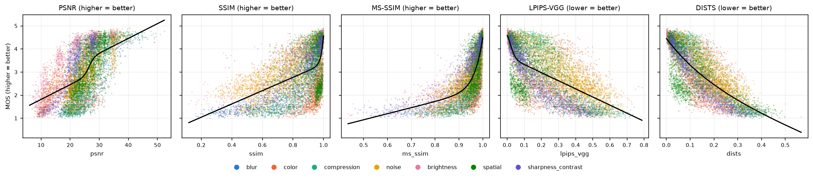
*Raw metric (native direction) vs MOS, coloured by distortion group; black = the fitted logistic. The negative slope of LPIPS/DISTS is the expected lower-is-better direction.*

**SRCC per distortion group** (`results/tables/by_group.csv`):

| group | PSNR | SSIM | MS-SSIM | LPIPS-VGG | DISTS |
|---|---|---|---|---|---|
| blur | 0.888 | 0.911 | 0.950 | 0.954 | **0.965** |
| brightness | **0.900** | 0.856 | 0.879 | 0.867 | 0.892 |
| color | 0.683 | **0.310** | **0.743** | 0.484 | 0.651 |
| compression | 0.827 | 0.855 | **0.918** | 0.906 | 0.917 |
| noise | 0.820 | 0.768 | **0.858** | 0.825 | 0.838 |
| sharpness & contrast | 0.872 | 0.866 | **0.923** | 0.906 | 0.918 |
| spatial | 0.681 | **0.386** | **0.713** | 0.531 | 0.632 |

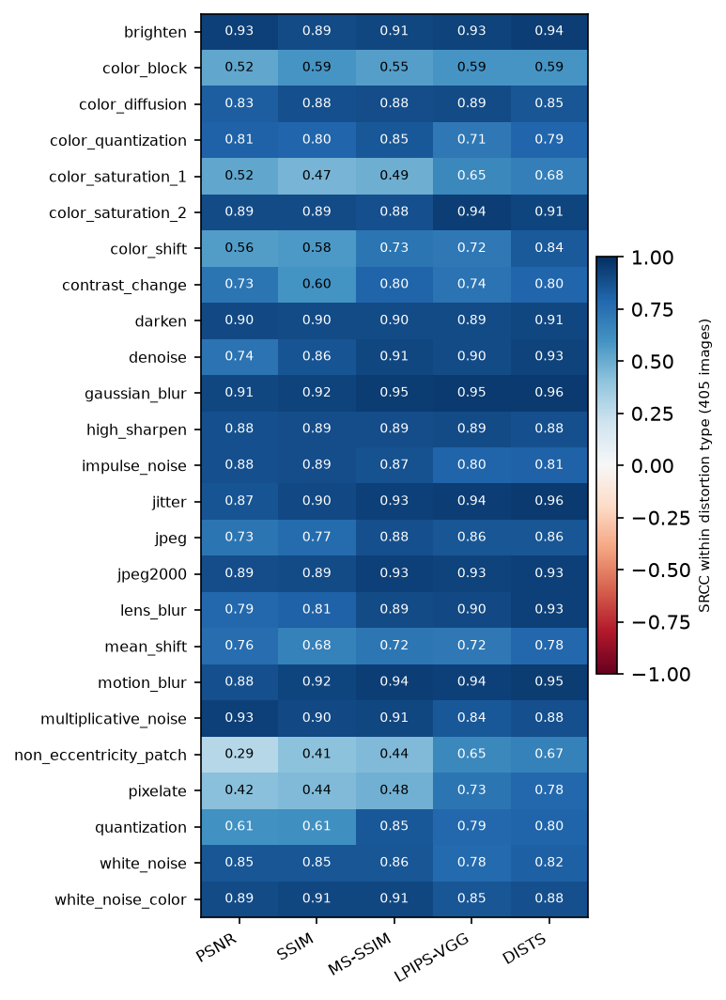
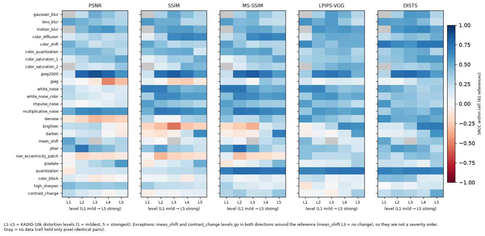
*SRCC inside each (distortion type, level) cell, 81 images per cell. x-axis: distortion level L1 (mildest) … L5 (strongest).*

**Interpretation (draft, B-10):**
1. **No metric wins everywhere.** MS-SSIM has the best overall SRCC (0.826) and wins 5 of 7 groups. DISTS wins blur and PSNR wins brightness. On blur, compression, and sharpness/contrast every metric is within 0.08 of the best.
2. **Within type vs across types.** Within a single distortion type, every metric ranks images well: the median SRCC per type is 0.83–0.88. The overall SRCC is much lower because a metric must also put *different* distortion types on one common scale. For example, SSIM reaches 0.88 within color diffusion but only 0.31 on the whole color group. LPIPS-VGG reaches 0.94 within jitter but 0.53 on spatial distortions *(verified)*. Most of the gap between metrics is therefore **cross-type calibration**, which is exactly where §4's failure cases come from.
3. **Color and spatial distortions are hard for everyone.** On color, the luma-only SSIM collapses to 0.31, while PSNR (RGB) and MS-SSIM (coarse scales) do much better. On spatial distortions (non-eccentricity patch, pixelate, jitter, color block), the pixel-aligned metrics fall to SRCC 0.29–0.48 on non-eccentricity patch and pixelate, while LPIPS and DISTS reach 0.65–0.78.
4. **Formula vs backbone.** LPIPS-VGG (0.720) falls behind DISTS (0.814) even though both use the same VGG16. Within types they are close, so DISTS's global texture/structure statistics, plus its training on KADID, calibrate better across types. Changing the LPIPS backbone to AlexNet gives 0.822 (`lpips_backbone.csv`), so the backbone matters as much as the formula.
5. **Logistic fit.** PLCC improves over raw PLCC mostly for PSNR (0.556 → 0.680) and MS-SSIM (0.680 → 0.823), whose relation to MOS is strongly non-linear (scatter); DISTS is almost linear (0.806 → 0.814).

**Monotonicity check (B-06; `results/tables/monotonicity_by_type.csv`).** For each (reference, type) we test whether the aligned score never improves as the level rises.
- Across all types the deep metrics are the most monotone: share LPIPS 0.90, DISTS 0.85, SSIM 0.83, MS-SSIM 0.82, PSNR 0.81. The mean Spearman(level, score) is between −0.89 and −0.92 for every metric.
- **MOS itself is monotone in only 62% of series**, because neighbouring levels often differ by less than the rating noise.
- Every metric and MOS score 0 on `mean_shift` and `contrast_change`. KADID's levels for these types go in both directions around the reference (mean-shift level 3 is the identity), so for them "level" is not a severity order.
- `pixelate` breaks the pixel-aligned metrics: PSNR/SSIM/MS-SSIM are monotone in ≤ 6% of series (the level-3 score is better than level 2), while LPIPS/DISTS are monotone in 100%. Block-grid alignment favours some block sizes at pixel level, but not perceptually.

**SSIM variants (B-22, D-20; `results/tables/ssim_variants.csv`).** Our SSIM (0.62) is low, so we changed one implementation choice at a time:

| SSIM variant | SRCC | PLCC | color group SRCC |
|---|---|---|---|
| pyiqa default (main): no downsampling, cs clamped | 0.619 | 0.628 | 0.310 |
| unclamped cs (textbook / skimage) | 0.619 | 0.628 | 0.310 |
| Wang's 2× downsampling (original MATLAB) | **0.752** | **0.748** | **0.704** |

- The cs clamp is irrelevant (the largest change on any image is 0.013).
- **Downsampling raises SRCC by 0.13**, almost entirely through the color group. Viewing scale therefore matters for SSIM: at 2× downsampling, the low-frequency luma side-effects of color distortions become visible to its 11×11 window. This agrees with case A-1 in §4.
- We keep the pyiqa default as the main score (D-26), because it is what the package computes for everyone, and report this sensitivity as a finding.

## 4. Failure Cases

**Reading the heatmaps:** the x-axis L1–L5 is the KADID-10k distortion level, from 1 (mildest) to 5 (strongest). The exceptions are mean shift and contrast change, whose levels go in both directions around the reference (mean-shift L3 = no change). Gray cells hold only pixel-identical pairs.

Each case shows a figure (reference | distorted | |diff| | 1−SSIM map | LPIPS-VGG map, with scores and global ranks $r$) and a heatmap. The heatmap's left panel is the case's signed score averaged per (type, level) cell over all references; the right panel is the selected image's reference; the black box marks the selected image.

Each case shows a figure (reference | distorted | |diff| | 1−SSIM map | LPIPS-VGG map, with scores and global ranks) and a heatmap. The heatmap's left panel is the case's signed score averaged per cell over all references; the right panel is the selected image's reference. The black box marks the selected image.

### 4.1 A-1: SSIM vs MS-SSIM: `I18_04_04` (color diffusion, level 4)

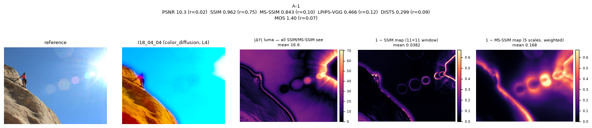
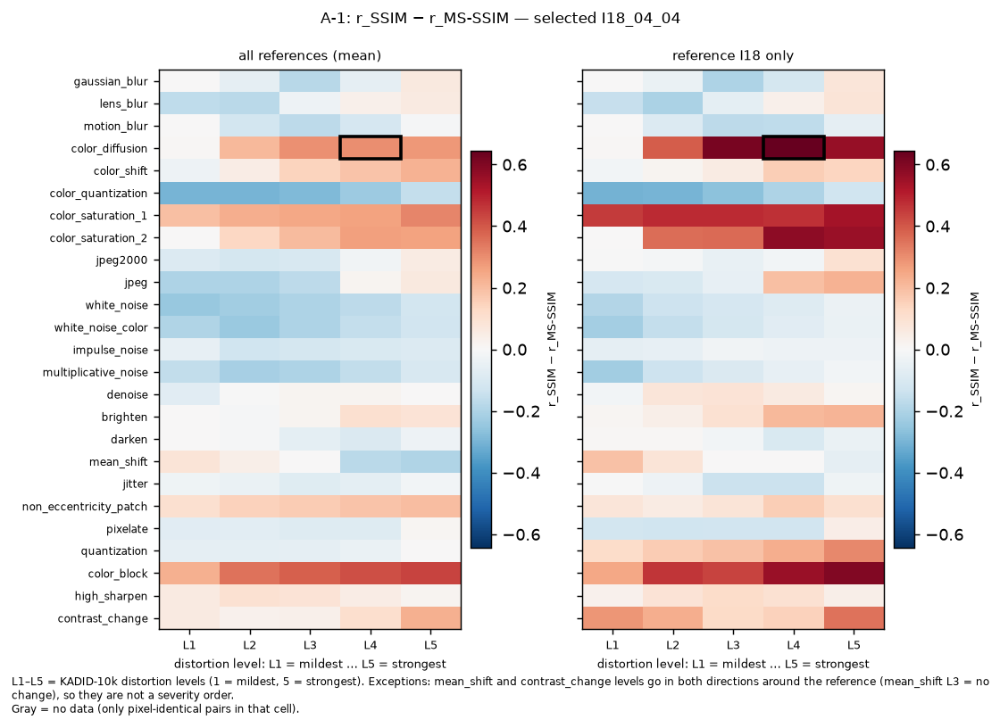
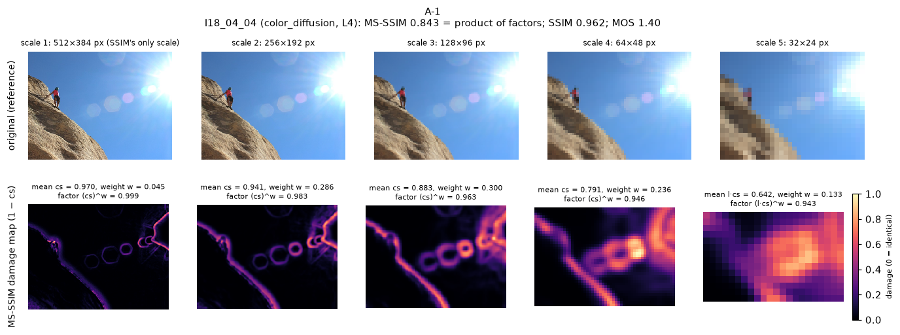
*MS-SSIM scale by scale. Row 1: the original image at each scale. Row 2: where MS-SSIM sees damage. The sun halo and the rock/sky edge become dominant at scales 3–5, where the weights are largest.*

| | PSNR | SSIM | MS-SSIM | LPIPS-VGG | DISTS | MOS |
|---|---|---|---|---|---|---|
| score | 10.27 dB | 0.962 | 0.843 | 0.466 | 0.299 | 1.40 |
| global rank $r$ | 0.02 | **0.75** | **0.10** | 0.12 | 0.09 | 0.07 |

- **Disagreement:** $g_A = 0.645$, the largest SSIM–MS-SSIM gap in the dataset. SSIM calls this image better than 75% of the dataset. MS-SSIM, every other metric and the humans put it in the bottom 10%. **MS-SSIM agrees with humans.**
- **Systematic or isolated:** the left heatmap shows the same red pattern for **color diffusion, color saturation and color block** (mean gap up to +0.44) across all references. This is a family-wide difference between the two metrics, and I18 is its most extreme instance.
- **Possible factors (draft):**
  - *Scale / spatial extent* *(verified)*. Both metrics see only luma (YIQ Y), and its mean barely changes (151.9 → 152.3). The structure-contrast term $cs$ is 0.97 at the finest scale (the 11×11 window that SSIM uses) and falls steadily to 0.89, 0.81 and 0.72 at the coarser scales, which MS-SSIM weights most (0.30, 0.24, 0.13). The luma damage is a **large-scale, low-frequency** change: the bright halo around the sun and the sky/rock boundary are smeared. A small window sees each patch as "almost unchanged", while a large window sees the change.
  - *Color.* Most of the visible damage, the sky turning cyan and the rock orange, is in **chroma**, which neither metric sees. Here MS-SSIM is right for a partly wrong reason: it catches the luma side-effect of the color change. Compare B-1, where the color change has no luma side-effect and MS-SSIM fails too.
  - *Cross-check with B-22 (verified).* With Wang's 2× downsampling, SSIM's rank for this image drops from 0.75 to 0.46, halving the gap. Viewing scale explains part of the disagreement.

### 4.2 A-2: LPIPS-VGG vs DISTS: `I38_19_04` (jitter, level 4)

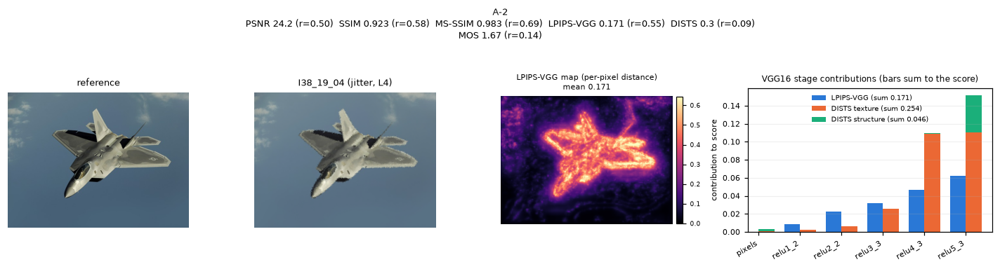
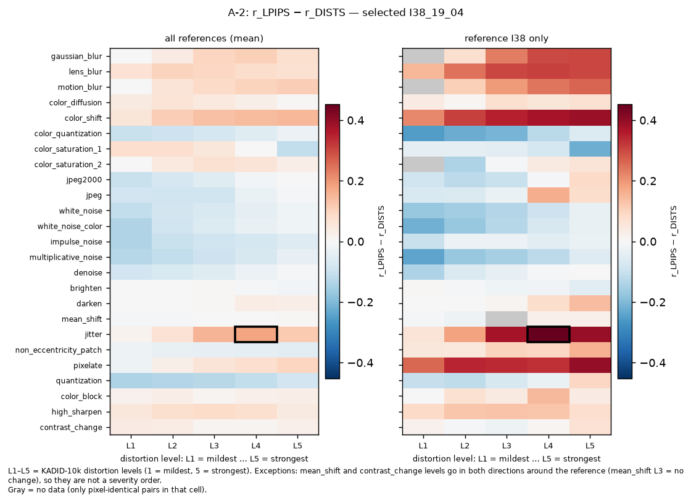

| | PSNR | SSIM | MS-SSIM | LPIPS-VGG | DISTS | MOS |
|---|---|---|---|---|---|---|
| score | 24.20 dB | 0.923 | 0.983 | 0.171 | 0.300 | 1.67 |
| global rank $r$ | 0.50 | 0.58 | 0.69 | **0.55** | **0.09** | 0.14 |

- **Disagreement:** gap 0.453. Both metrics use the same VGG16 backbone (D-23), so the difference comes from the **formula**. LPIPS-VGG places the image mid-pack, while DISTS and the humans place it near the bottom. **DISTS agrees with humans.**
- **Systematic or isolated:** within jitter alone both metrics order images almost perfectly (SRCC 0.94 LPIPS, 0.96 DISTS) *(verified)*. The failure is again **cross-type calibration**: the heatmap is red for jitter L3–L4 and color shift L4–L5 across all references, so LPIPS gives jitter smaller distances than its visual impact deserves.
- **Possible factors (draft):**
  - *Small geometric changes.* Jitter moves pixels by a few positions, so the outline of the jet becomes ragged (visible in the |diff| panel, concentrated on edges). LPIPS compares features **position by position** and averages them. Its learned weights come from 2AFC judgments on small patches, and those judgments may have taught it to discount small shifts.
  - *Structure vs texture statistics.* DISTS compares **global** mean and correlation statistics of each feature map (its structure term). Breaking every straight edge of a large, salient object changes those statistics a lot.
  - *Salient region.* All the damage is on the object, the region viewers look at. Neither metric weights saliency, but this could explain why the human score is so low.

### 4.3 B-1: metric vs MOS, rank view (SRCC): SSIM on `I32_04_02` (color diffusion, level 2)

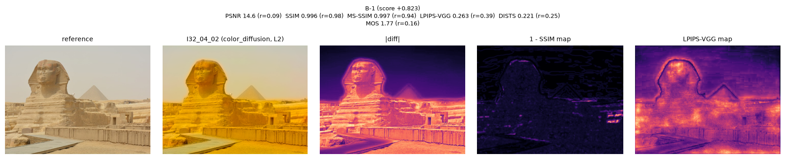
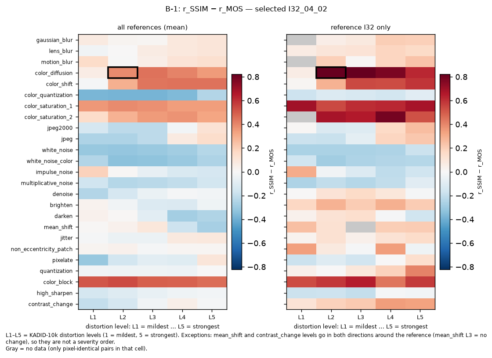
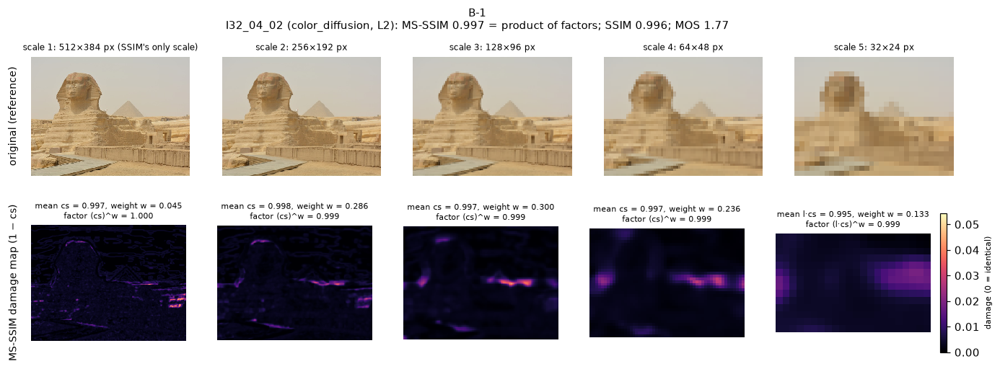
*MS-SSIM scale by scale: the damage is below 0.05 at every scale (note the colour-bar range). No scale sees the yellow cast, because it is in chroma.*

| | PSNR | SSIM | MS-SSIM | LPIPS-VGG | DISTS | MOS |
|---|---|---|---|---|---|---|
| score | 14.57 dB | **0.996** | 0.997 | 0.263 | 0.221 | 1.77 |
| global rank $r$ | 0.09 | **0.98** | 0.94 | 0.39 | 0.25 | 0.16 |

- **Disagreement:** $r_{SSIM} - r_{MOS} = +0.823$, the largest rank error of any metric on any image. SSIM is **too optimistic**: it rates the image better than 98% of the dataset, while humans rate it worse than 84%. In terms of $d_i$ this single image contributes $(0.823 N)^2$ to $\sum d^2$.
- **The same image tops the PLCC view too.** It has the largest logistic residual of all, $e_{SSIM} = +2.56$ MOS: SSIM's fitted MOS is 4.33, while humans gave 1.77. B-2 therefore shows the next distinct image.
- **Systematic or isolated:** systematic. SSIM is off by more than 0.5 rank for **20.7%** of color-diffusion images (and 21.7% of color saturation 1, 46.9% of color block). Yet within color diffusion SSIM's SRCC is 0.875 *(verified)*. It orders these images correctly but places all of them far too high relative to other distortion types. The heatmap is red along whole rows (color block, color diffusion, color saturation), not in isolated cells.
- **Possible factors (draft):**
  - *Color.* SSIM (and MS-SSIM) in pyiqa use **only the luma channel** (YIQ Y). Here the luma is almost unchanged: mean Y goes from 171.1 to 166.2, and $cs \ge 0.995$ at every scale *(verified)*. The distortion is a strong **yellow cast**, purely chromatic, so the metric cannot see it.
  - *Cross-check with B-22 (verified).* With 2× downsampling SSIM still ranks this image at 0.97, so scale is not the cause here; color is.
  - PSNR, which uses RGB, sees it (14.6 dB, rank 0.09), and so do LPIPS/DISTS, which use RGB features. The cue SSIM lacks is therefore color information, not some deeper perceptual model.

### 4.4 B-2: metric vs MOS, value view (PLCC): DISTS on `I81_20_05` (non-eccentricity patch, level 5)

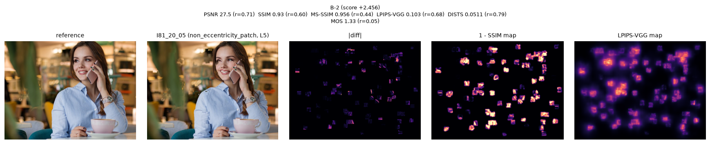
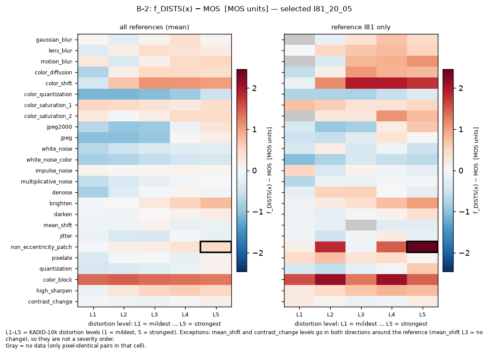

| | PSNR | SSIM | MS-SSIM | LPIPS-VGG | DISTS | MOS |
|---|---|---|---|---|---|---|
| score | 27.54 dB | 0.930 | 0.956 | 0.103 | **0.051** | 1.33 |
| global rank $r$ | 0.71 | 0.60 | 0.44 | 0.68 | **0.79** | 0.05 |
| fitted MOS $f_m(\tilde s)$ | | | | | **3.79** | 1.33 |

- **Disagreement:** $e_{DISTS} = +2.46$ MOS. The logistic mapping turns DISTS's very small distance into a predicted MOS of 3.79 ("good"), while humans gave 1.33 ("bad"). The residual is 2.46 points on a 4-point scale. This is the third-ranked (metric, image) pair overall, and the first one whose image is not already used by B-1. Every metric is optimistic here (all ranks ≥ 0.44), but DISTS is the most optimistic.
- **Systematic or isolated:** isolated. Only 1.2% of non-eccentricity-patch images have a DISTS rank error above 0.5, and within this type DISTS's SRCC is 0.67 *(verified)*. On the I81 row of the heatmap, L2 and L5 are dark red while L3 is near 0. The failure depends on **where the patches land**, not on the distortion type. (Across all references, DISTS's large positive residuals are on **color block** and **color shift**.)
- **Possible factors (draft):**
  - *Spatial localization.* This distortion copies many small patches to nearby positions. The damage is local and sparse (see the |diff| map); most of the image is untouched.
  - DISTS compares **global** feature statistics (means and variances over the whole map). Moving patches around inside the same image leaves those statistics almost unchanged. DISTS was in fact designed to tolerate this kind of texture resampling.
  - *Salient / semantic content.* The patches create small discontinuities on the shirt, hair, phone and cup edges, near the face. Viewers notice discontinuities on a person and on object contours much more than the area fraction suggests.

### 4.5 C-1: SSIM vs LPIPS-VGG ranking: `I43_07_05` vs `I43_25_01` (reference I43)

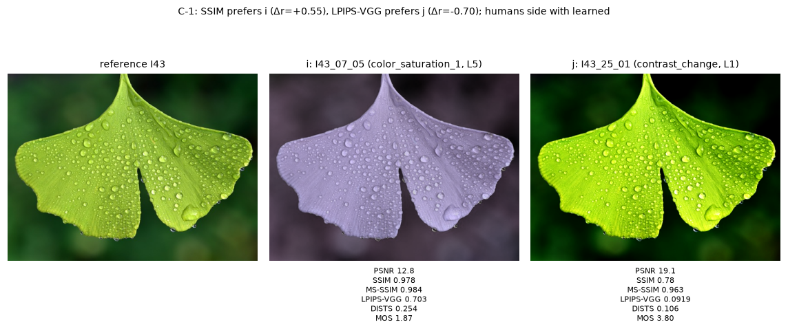
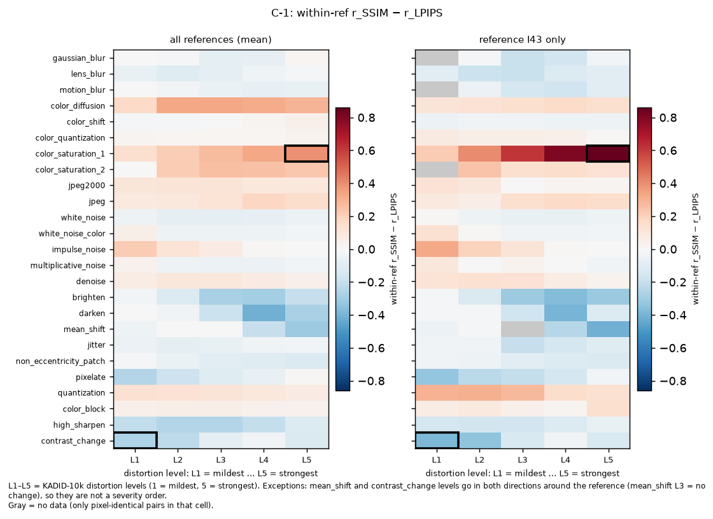

| image | type, level | SSIM | LPIPS-VGG | MOS | $r^{ref}_{SSIM}$ | $r^{ref}_{LPIPS}$ | $r^{ref}_{MOS}$ |
|---|---|---|---|---|---|---|---|
| $i$ = I43_07_05 | color saturation 1, L5 | 0.978 | 0.703 | 1.87 | **0.87** | **0.01** | 0.08 |
| $j$ = I43_25_01 | contrast change, L1 | 0.780 | 0.092 | 3.80 | **0.32** | **0.71** | 0.62 |

- **Disagreement:** $\Delta r_{SSIM} = +0.55$ (SSIM prefers $i$), $\Delta r_{LPIPS} = -0.70$ (LPIPS prefers $j$), strength 0.55, the strongest such conflict with a clear human preference. Humans prefer $j$ by **1.93 MOS**, so **humans side with LPIPS-VGG**. Over all 78,769 SSIM–LPIPS conflicts, humans side with LPIPS in 43%, with SSIM in 24%, and 34% are ties.
- **Systematic or isolated:** systematic. The left heatmap (within-reference $r_{SSIM} - r_{LPIPS}$) is red for color saturation, color diffusion and quantization, and blue for brighten, darken, mean shift, contrast change and high sharpen. SSIM is lenient on color changes and harsh on luminance and contrast changes compared with LPIPS.
- **Possible factors (draft):**
  - *Color (image $i$).* The leaf becomes lavender-gray: hue and saturation change while the luma structure (veins, drops) is intact. SSIM, which sees luma only, scores 0.978. LPIPS uses RGB deep features, which respond strongly to color, and scores it the worst image of the reference.
  - *Contrast (image $j$).* The contrast is increased: a brighter, more saturated leaf and a darker background. SSIM's contrast term $\frac{2\sigma_x\sigma_y + C_2}{\sigma_x^2 + \sigma_y^2 + C_2}$ penalises *any* change of local variance, including an increase. Humans see an "enhanced" leaf, and LPIPS's normalised deep features are relatively insensitive to such a global contrast change.

---

## 5. Discussion

**Strengths.**
- *PSNR* is robust to global brightness changes; it has the best brightness-group SRCC, because a brightness shift is exactly an error in pixel values.
- *SSIM and MS-SSIM* are strong on blur, compression and noise, where structure is lost. MS-SSIM's multi-scale design makes it the best single metric on KADID overall.
- *LPIPS-VGG and DISTS* are the only metrics that stay monotone and reasonably correlated on spatial distortions (pixelate, jitter, patches), where pixel alignment breaks.

**Limitations.**
- *Calibration across types* is the main weakness of every metric (§3, point 2). A metric can order the five levels of one distortion correctly and still place that whole distortion at the wrong quality compared with another.
- *Color.* SSIM and MS-SSIM ignore chroma by design (luma only), which explains cases B-1 and C-1. LPIPS sees color but over-penalises some color changes relative to others (color group SRCC 0.48).
- *Scale.* Single-scale SSIM misses large, low-frequency changes (case A-1, and +0.13 SRCC with downsampling).
- *Global statistics.* DISTS pools features over the whole image, so sparse, local damage can go unnoticed (case B-2).

**Does any single metric consistently reflect human perception? No.**
- The best overall metric (MS-SSIM, 0.83) still fails on color saturation (0.49), non-eccentricity patch (0.44) and pixelate (0.48).
- The learned metrics win exactly there but lose to MS-SSIM overall, and the stronger learned one (DISTS) was trained on this dataset.
- The ranking of the metrics changes with the distortion type (heatmaps in §3).

**A perceptual factor not adequately captured:**
- **Chromatic change.** SSIM and MS-SSIM cannot see it, and the deep metrics do not scale it consistently against other distortions (color group SRCC 0.48–0.74 for every metric vs ≥ 0.89 on blur).
- A second candidate is **localized damage on salient content** (case B-2). No metric weights *where* the viewer looks.

| case | metric that fails | factor it ignores or over-weights | systematic? |
|---|---|---|---|
| A-1 | SSIM | large-scale (low-frequency) changes: single small window | yes (color types) |
| A-2 | LPIPS-VGG | ragged edges from small geometric jitter; calibration across types | yes (jitter, color shift) |
| B-1 | SSIM (and MS-SSIM) | **color**: luma-only input | yes (20.7% of color diffusion) |
| B-2 | DISTS | **spatial localization**: global statistics ignore sparse local patch moves | no (content-specific) |
| C-1 | SSIM | color (ignored) and contrast enhancement (over-penalised) | yes |

Candidate answer to the spec question *"a perceptual factor not adequately captured"*: **chromatic change.** It is invisible to SSIM and MS-SSIM (luma only) and only weakly scaled across types by LPIPS. A second candidate is **sparse, localized damage on salient content**, which DISTS's global statistics miss.

## Contribution Statement (draft, B-17)
- **@hwupu (Member A):** project lead (PO); planning, code with an AI coding agent (data loader, metric registry, scoring, evaluation, failure mining, figures), drafted the report, selected the five cases by quantitative criteria.
- **@ALLEN07056 (Member B):** code reviewer for all PRs, cross-platform verification on WSL, verification of results and failure-case explanations, report review.

**Generative AI disclosure (draft).**
- Claude Code (Claude Opus 5.5) was used to write code, run the experiments and draft the text.
- Every AI interaction that produced kept output is logged in `doc/PROMPT_LOG.md` (P-001 to P-010), and every design choice in `doc/DECISIONS.md`.
- Humans chose the case-selection rules, reviewed every PR, and own the final explanations.

## References
- H. Lin, V. Hosu, D. Saupe, "KADID-10k: A large-scale artificially distorted IQA database," QoMEX 2019.
- Z. Wang, A. C. Bovik, H. R. Sheikh, E. P. Simoncelli, "Image quality assessment: from error visibility to structural similarity," IEEE TIP 2004.
- Z. Wang, E. P. Simoncelli, A. C. Bovik, "Multiscale structural similarity for image quality assessment," Asilomar 2003.
- R. Zhang, P. Isola, A. A. Efros, E. Shechtman, O. Wang, "The unreasonable effectiveness of deep features as a perceptual metric," CVPR 2018.
- K. Ding, K. Ma, S. Wang, E. P. Simoncelli, "Image quality assessment: unifying structure and texture similarity," IEEE TPAMI 2022.
- H. R. Sheikh, M. F. Sabir, A. C. Bovik, "A statistical evaluation of recent full reference image quality assessment algorithms," IEEE TIP 2006 (logistic mapping).
- C. Chen, J. Mo, "IQA-PyTorch (pyiqa)," https://github.com/chaofengc/IQA-PyTorch.

## Remaining before submission (Release: B-18, B-19)
- [ ] Convert to PDF (D-08) and cut to ≤ 4 pages: keep 1 image figure per case, the scatter plot, one heatmap; move the rest to the repo.
- [ ] Clean-clone reproduction on WSL (B-18; macOS done).
- [ ] Submit the PDF + repository link (B-19).
